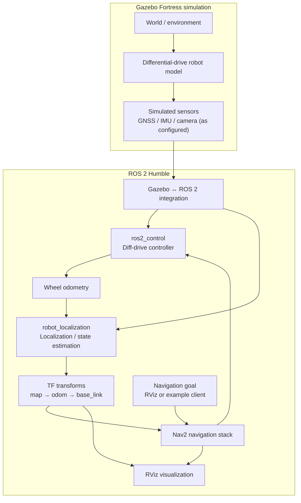

# System architecture

This is a **conceptual architecture view** of the upstream SMART diffbot stack, based on its package structure and documentation. It is not a captured runtime graph. Confirm actual topic names, sensor availability, TF frames and node connections when the system is launched.



## Main data/control path

1. Gazebo simulates the environment and robot.
2. The ROS-Gazebo integration exposes simulation data and interfaces to ROS 2.
3. The control layer accepts velocity commands and provides wheel odometry.
4. Localization combines configured motion/sensor inputs and publishes state/TF information.
5. Nav2 uses the configured robot, localization and environment information to plan and execute navigation.
6. A goal is supplied through RViz or an example client; Nav2 produces velocity commands for the controller.

## What to verify at runtime

Do not assume the exact topic and frame names from this diagram. Inspect the running system:

```bash
ros2 node list
ros2 topic list
ros2 topic info /clock
ros2 topic info /tf
ros2 run tf2_tools view_frames
ros2 lifecycle nodes
```

Check the actual launch files and parameter YAML files if a topic, frame or node differs from the conceptual diagram.

## Package responsibilities

| Package | Responsibility (upstream documented structure) |
|---|---|
| `smart_diffbot_bringup` | World, robot spawn and launch orchestration |
| `smart_diffbot_control` | Controller setup and robot control |
| `smart_diffbot_localization` | Localization launch/configuration |
| `smart_diffbot_navigation` | Navigation launch/configuration |
| `smart_diffbot_clients` | Example docking and line-following clients |

## Diagram status

- Diagram type: conceptual / documentation-derived
- Runtime graph captured: no
- Topic and TF names verified: pending
- Last reviewed: 2026-11-10
