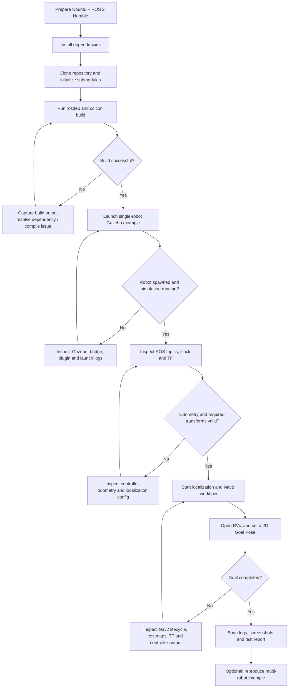

# Navigation workflow

This workflow describes the upstream project's documented simulation and navigation path. Run it on the target Ubuntu + ROS 2 Humble + Gazebo Fortress environment and record the actual outcome before marking any stage verified.



## Upstream example commands

The upstream README documents these example entry points:

**Single-robot simulation**

```bash
ros2 launch smart_diffbot_bringup single_robot_sim_example.launch.py
```

**RViz**

```bash
ros2 launch smart_diffbot_navigation rviz.launch.py
```

**Example clients**

```bash
ros2 run smart_diffbot_clients docking_client
ros2 run smart_diffbot_clients line_follow_client
```

**Multi-robot simulation**

```bash
ros2 launch smart_diffbot_bringup multi_robot_sim_example.launch.py
```

Follow the upstream README and inspect launch files for the exact order and terminal separation needed for each scenario.

## Navigation debugging checklist

- [ ] Gazebo is running and simulation clock is available.
- [ ] Robot entity is spawned.
- [ ] Controller manager and required controllers are active.
- [ ] Command velocity input is connected to the drive controller.
- [ ] Odometry is published and changes when the robot moves.
- [ ] Required TF chain is connected and timestamps are valid.
- [ ] Localization nodes are active and publish expected outputs.
- [ ] Nav2 lifecycle nodes are active.
- [ ] Costmaps load and update without transform errors.
- [ ] RViz displays the robot and navigation data.
- [ ] A reachable goal is accepted and completed.
- [ ] Logs and evidence are attached to the test report.

A launch process starting successfully is not proof that navigation works. Verify the robot motion and goal result.
